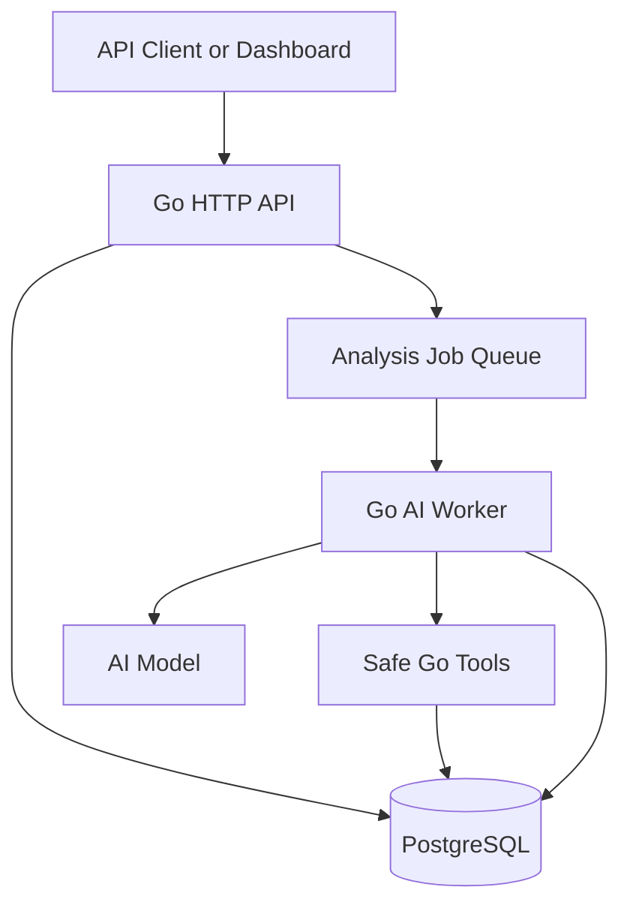
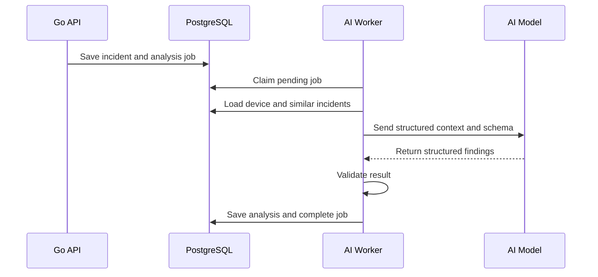

# OpsAI — Project Blueprint

## 1. Project Summary

**OpsAI** is an AI-assisted incident analysis platform for industrial equipment such as AMRs, conveyors, PLC-connected machines, and other devices.

An engineer submits an alarm, logs, symptoms, and device information. OpsAI collects relevant operational context, searches similar historical incidents, and returns a structured troubleshooting analysis. Engineers can review, correct, and resolve the incident, creating better knowledge for future analysis.

### Portfolio statement

> OpsAI is a production-oriented incident analysis platform built with Go, PostgreSQL, MQTT, and AI tool calling. It helps engineers diagnose equipment problems using live device context, historical incidents, and technical knowledge.

## 2. Project Goals

The project should demonstrate that you can:

- Build and structure a production-style Go backend.
- Design reliable APIs and database transactions.
- Use goroutines and workers for asynchronous processing.
- Integrate an LLM safely using structured output and tool calling.
- Implement retrieval-augmented generation (RAG).
- Process MQTT equipment events.
- Add authentication, authorization, testing, observability, and deployment.
- Apply industrial automation knowledge to a real business problem.

## 3. Users and Roles

| Role | Capabilities |
| --- | --- |
| Operator | View devices, submit incidents, and view analysis results. |
| Engineer | All operator capabilities, review AI findings, add notes, and resolve incidents. |
| Admin | Manage users, devices, document sources, and system configuration. |

The MVP can initially use a single engineer role. Role-based access control can be added after the core workflow works.

## 4. Core User Journey

1. An engineer registers or selects a device.
2. The engineer creates an incident containing an alarm code, symptoms, and logs.
3. The API stores the incident with the status `open`.
4. A background worker starts an AI analysis job.
5. The AI orchestration layer retrieves device context and similar resolved incidents.
6. The model returns validated, structured findings.
7. The system stores the analysis and changes the incident status to `analyzed`.
8. The engineer reviews the result, adds corrective action, and resolves the incident.
9. The resolved incident becomes searchable knowledge for future cases.

## 5. MVP Scope

### Included

- Health-check endpoint.
- Device registration and listing.
- Incident creation, listing, and detail endpoints.
- Asynchronous AI incident analysis.
- Strictly validated AI JSON output.
- Similar-incident retrieval using PostgreSQL.
- Engineer review and incident resolution.
- PostgreSQL migrations.
- Structured logging.
- Unit and integration tests for critical workflows.
- Docker Compose for the API and PostgreSQL.
- OpenAPI documentation.

### Deferred until after the MVP

- MQTT ingestion.
- Live WebSocket or Server-Sent Events updates.
- Document-based RAG for SOPs and manuals.
- Full authentication and role-based access control.
- Web dashboard.
- Multiple AI providers.
- Advanced monitoring and distributed tracing.
- Automatic maintenance-task creation.

## 6. System Architecture



For the MVP, the queue can be a PostgreSQL-backed `analysis_jobs` table. This avoids introducing Redis too early and demonstrates reliable job processing. A worker polls pending jobs, claims one transactionally, processes it, and records success or failure.

## 7. Recommended Technology Stack

| Area | Recommendation | Purpose |
| --- | --- | --- |
| Language | Go | API, workers, orchestration, and integrations. |
| HTTP router | `chi` or Go standard library | Lightweight routing and middleware. |
| Database | PostgreSQL | Devices, incidents, analyses, jobs, and knowledge. |
| Database driver | `pgx` | PostgreSQL access. |
| Query generation | `sqlc` | Type-safe Go code generated from SQL. |
| Migrations | `goose` | Version-controlled schema changes. |
| AI integration | Provider SDK behind an interface | Structured output and tool calling without coupling the domain to one provider. |
| Validation | Go structs plus explicit validation | Validate API and AI data at boundaries. |
| Logging | `slog` | Structured application logs. |
| Testing | `testing`, `httptest`, and test containers | Unit, handler, repository, and integration tests. |
| Local environment | Docker Compose | Reproducible API and database setup. |
| CI | GitHub Actions | Formatting, static analysis, tests, and build. |

## 8. Domain Model

### Device

```text
id
name
type
location
status
metadata
created_at
updated_at
```

Suggested device types: `amr`, `conveyor`, `plc`, `robot`, and `other`.

### Incident

```text
id
device_id
title
description
alarm_code
severity
status
raw_logs
reported_by
occurred_at
created_at
updated_at
resolved_at
```

Suggested status transitions:

```text
open -> analyzing -> analyzed -> resolved
                  \-> analysis_failed
```

### Incident Analysis

```text
id
incident_id
summary
primary_suspected_cause
contributing_factors
observed_conditions
recommended_actions
safety_notes
confidence
evidence
model_name
prompt_version
created_at
review_status
reviewed_by
review_notes
```

### Analysis Job

```text
id
incident_id
status
attempt_count
available_at
locked_at
last_error
created_at
updated_at
```

### Resolution

```text
id
incident_id
root_cause
corrective_action
preventive_action
resolved_by
created_at
```

## 9. Initial Database Tables

```sql
CREATE TABLE devices (
    id UUID PRIMARY KEY,
    name TEXT NOT NULL,
    type TEXT NOT NULL,
    location TEXT,
    status TEXT NOT NULL DEFAULT 'unknown',
    metadata JSONB NOT NULL DEFAULT '{}',
    created_at TIMESTAMPTZ NOT NULL DEFAULT NOW(),
    updated_at TIMESTAMPTZ NOT NULL DEFAULT NOW()
);

CREATE TABLE incidents (
    id UUID PRIMARY KEY,
    device_id UUID REFERENCES devices(id),
    title TEXT NOT NULL,
    description TEXT NOT NULL,
    alarm_code TEXT,
    severity TEXT NOT NULL,
    status TEXT NOT NULL DEFAULT 'open',
    raw_logs TEXT[] NOT NULL DEFAULT '{}',
    occurred_at TIMESTAMPTZ,
    created_at TIMESTAMPTZ NOT NULL DEFAULT NOW(),
    updated_at TIMESTAMPTZ NOT NULL DEFAULT NOW(),
    resolved_at TIMESTAMPTZ
);

CREATE TABLE incident_analyses (
    id UUID PRIMARY KEY,
    incident_id UUID NOT NULL REFERENCES incidents(id),
    result JSONB NOT NULL,
    confidence DOUBLE PRECISION,
    model_name TEXT NOT NULL,
    prompt_version TEXT NOT NULL,
    review_status TEXT NOT NULL DEFAULT 'pending',
    review_notes TEXT,
    created_at TIMESTAMPTZ NOT NULL DEFAULT NOW()
);

CREATE TABLE analysis_jobs (
    id UUID PRIMARY KEY,
    incident_id UUID NOT NULL REFERENCES incidents(id),
    status TEXT NOT NULL DEFAULT 'pending',
    attempt_count INTEGER NOT NULL DEFAULT 0,
    available_at TIMESTAMPTZ NOT NULL DEFAULT NOW(),
    locked_at TIMESTAMPTZ,
    last_error TEXT,
    created_at TIMESTAMPTZ NOT NULL DEFAULT NOW(),
    updated_at TIMESTAMPTZ NOT NULL DEFAULT NOW()
);
```

Use migrations rather than executing this schema manually. Add constraints for allowed statuses and severity values as the domain stabilizes.

## 10. API Blueprint

### Health

| Method | Endpoint | Purpose |
| --- | --- | --- |
| GET | `/health` | Process health. |
| GET | `/ready` | Database and dependency readiness. |

### Devices

| Method | Endpoint | Purpose |
| --- | --- | --- |
| POST | `/api/v1/devices` | Register a device. |
| GET | `/api/v1/devices` | List devices. |
| GET | `/api/v1/devices/{id}` | Get one device. |
| PATCH | `/api/v1/devices/{id}` | Update device data or status. |

### Incidents

| Method | Endpoint | Purpose |
| --- | --- | --- |
| POST | `/api/v1/incidents` | Create an incident and enqueue analysis. |
| GET | `/api/v1/incidents` | List and filter incidents. |
| GET | `/api/v1/incidents/{id}` | Get the incident and latest analysis. |
| POST | `/api/v1/incidents/{id}/analyze` | Retry or request analysis. |
| POST | `/api/v1/incidents/{id}/review` | Accept, reject, or annotate AI findings. |
| POST | `/api/v1/incidents/{id}/resolve` | Record verified resolution. |

### Example incident request

```json
{
  "device_id": "6c5738ce-b611-4b6f-9154-3abc9f5b8bb4",
  "title": "AMR failed to dock with rack",
  "description": "The AMR started position correction and stopped near another rack.",
  "alarm_code": "DOCKING_FAILED",
  "severity": "high",
  "raw_logs": [
    "QR rack not detected",
    "Position correction started",
    "Obstacle detected during correction"
  ],
  "occurred_at": "2026-09-14T09:30:00Z"
}
```

### Example accepted response

```json
{
  "data": {
    "id": "d31a2890-3561-4026-917e-ce91ac57cc85",
    "status": "open",
    "analysis_status": "queued"
  }
}
```

Use a consistent error envelope:

```json
{
  "error": {
    "code": "VALIDATION_ERROR",
    "message": "The request contains invalid fields.",
    "details": {
      "severity": "must be one of low, medium, high, critical"
    }
  }
}
```

## 11. AI Analysis Contract

The model must produce structured data matching a Go type. Free-form model text must never be stored as if it were verified engineering data.

```go
type IncidentAnalysis struct {
    Summary               string     `json:"summary"`
    PrimarySuspectedCause string     `json:"primary_suspected_cause"`
    ContributingFactors   []string   `json:"contributing_factors"`
    ObservedConditions    []string   `json:"observed_conditions"`
    RecommendedActions    []Action   `json:"recommended_actions"`
    SafetyNotes           []string   `json:"safety_notes"`
    Evidence              []Evidence `json:"evidence"`
    Confidence            float64    `json:"confidence"`
}

type Action struct {
    Order       int    `json:"order"`
    Description string `json:"description"`
    Reason      string `json:"reason"`
}

type Evidence struct {
    SourceID string `json:"source_id"`
    Claim    string `json:"claim"`
}
```

### AI safety rules

- Clearly separate observations from suspected causes.
- Never claim that a root cause is confirmed unless an engineer confirms it.
- Do not invent alarm meanings, measurements, manuals, or previous incidents.
- Cite retrieved incident or document IDs in `evidence`.
- Include safety notes when an action could affect moving equipment or electrical systems.
- Ask for missing information when evidence is insufficient.
- Validate output before saving it.
- Keep a human review step before resolution or maintenance actions.

## 12. AI Orchestration Flow



### Initial AI tools

Expose only read-only tools in the first version:

```text
get_device_details(device_id)
get_recent_incidents(device_id, limit)
search_similar_incidents(query, limit)
get_incident_resolution(incident_id)
```

Later, a `create_maintenance_task` tool can be added with explicit user approval and authorization.

## 13. Retrieval Strategy

### MVP retrieval

Start with PostgreSQL text search and filters:

- Same alarm code.
- Same device type.
- Similar title and description.
- Only resolved incidents with verified corrective actions.

### RAG upgrade

Add embeddings and vector search after the basic workflow is reliable:

1. Split SOPs and manuals into small sections.
2. Store content, metadata, and embeddings.
3. Retrieve the most relevant sections.
4. Provide only retrieved sections to the model.
5. Require document and section IDs in the evidence output.

Do not begin with document RAG. Historical incident retrieval is simpler to evaluate and more closely connected to the core product.

## 14. Go Project Structure

```text
opsai-incident-platform/
├── cmd/
│   ├── api/main.go
│   └── worker/main.go
├── internal/
│   ├── config/
│   ├── domain/
│   │   ├── device.go
│   │   ├── incident.go
│   │   └── analysis.go
│   ├── service/
│   │   ├── incident_service.go
│   │   └── analysis_service.go
│   ├── repository/
│   │   ├── device_repository.go
│   │   ├── incident_repository.go
│   │   └── job_repository.go
│   ├── ai/
│   │   ├── client.go
│   │   ├── prompt.go
│   │   ├── tools.go
│   │   └── validator.go
│   ├── worker/
│   │   └── analysis_worker.go
│   ├── transport/http/
│   │   ├── handler/
│   │   ├── middleware/
│   │   └── router.go
│   └── platform/
│       ├── database/
│       └── logging/
├── db/
│   ├── migrations/
│   ├── queries/
│   └── sqlc.yaml
├── api/openapi.yaml
├── tests/
├── Dockerfile
├── compose.yaml
├── Makefile
├── go.mod
└── README.md
```

Keep domain and service layers independent from the HTTP router, PostgreSQL driver, and AI provider. Interfaces should be introduced at the consumer boundary when they help testing or replacement; avoid creating interfaces for every struct prematurely.

## 15. Important Go Interfaces

```go
type IncidentRepository interface {
    Create(ctx context.Context, incident Incident) (Incident, error)
    GetByID(ctx context.Context, id uuid.UUID) (Incident, error)
    ListSimilar(ctx context.Context, input SimilarIncidentInput) ([]Incident, error)
    UpdateStatus(ctx context.Context, id uuid.UUID, status IncidentStatus) error
}

type AIAnalyzer interface {
    AnalyzeIncident(ctx context.Context, input AnalysisInput) (IncidentAnalysis, error)
}

type JobRepository interface {
    Enqueue(ctx context.Context, incidentID uuid.UUID) error
    ClaimNext(ctx context.Context) (AnalysisJob, error)
    Complete(ctx context.Context, jobID uuid.UUID) error
    Fail(ctx context.Context, jobID uuid.UUID, cause error) error
}
```

Pass `context.Context` through every database, network, and AI operation. Apply timeouts at process boundaries.

## 16. Background Worker Behavior

The worker should:

1. Poll for an available job.
2. Claim it using a transaction and row locking.
3. Mark the incident as `analyzing`.
4. Load incident, device, and retrieval context.
5. Call the AI provider with a timeout.
6. Validate the returned structure.
7. Store the analysis transactionally.
8. Mark the incident as `analyzed` and the job as `completed`.
9. Retry transient failures with exponential backoff.
10. Mark permanent failures as `failed` after a fixed attempt limit.

Use a small, configurable worker pool. Implement graceful shutdown so active jobs receive a cancellation signal and the API stops accepting new requests before the process exits.

## 17. Testing Strategy

| Test type | What to verify |
| --- | --- |
| Unit | Domain validation, status transitions, prompt building, AI output validation, retry decisions. |
| Handler | HTTP status, JSON content type, request validation, and error envelopes. |
| Repository integration | SQL queries, transactions, locking, and migrations against PostgreSQL. |
| Service integration | Incident creation enqueues exactly one analysis job. |
| Worker integration | A queued job produces a stored analysis or a recorded failure. |
| AI contract | Invalid or incomplete model output is rejected. |
| Evaluation dataset | Expected suspected causes and evidence for representative incidents. |

Create at least ten anonymized test incidents, including docking failure, QR detection failure, low battery, communication timeout, conveyor sensor blockage, and PLC connection loss.

## 18. Observability

Every request and job should include a correlation ID. Log structured fields such as:

```text
request_id
incident_id
device_id
job_id
duration_ms
attempt
model_name
token_usage
status
error_code
```

Never log credentials, full authorization headers, or sensitive document content. Later metrics can include request duration, jobs pending, analysis duration, retry count, AI errors, token usage, and estimated model cost.

## 19. Configuration

Suggested environment variables:

```text
APP_ENV
HTTP_ADDRESS
DATABASE_URL
AI_API_KEY
AI_MODEL
AI_REQUEST_TIMEOUT
WORKER_CONCURRENCY
JOB_POLL_INTERVAL
JOB_MAX_ATTEMPTS
LOG_LEVEL
```

Validate configuration at startup and fail with a clear error when required values are missing. Commit an `.env.example`, never a real `.env` file.

## 20. Security Checklist

- Validate request size and field length.
- Limit the number and size of log entries.
- Use parameterized SQL.
- Store secrets only in environment or secret-management systems.
- Apply authentication before exposing the deployment publicly.
- Authorize access to device and incident resources.
- Rate-limit incident analysis requests.
- Treat retrieved documents and user logs as untrusted input.
- Prevent AI tools from executing arbitrary SQL, shell commands, or device commands.
- Require human confirmation for future write or control tools.
- Keep an audit record for analysis requests, reviews, and resolutions.

## 21. Implementation Roadmap

### Milestone 1 — Go API foundation

- Initialize the Go module.
- Add configuration and structured logging.
- Implement `/health` and `/ready`.
- Add graceful shutdown.
- Add standard success and error response helpers.
- Add initial unit tests.

**Done when:** the API starts locally, reports readiness, returns JSON errors consistently, passes tests, and shuts down cleanly.

### Milestone 2 — PostgreSQL and devices

- Add Docker Compose and PostgreSQL.
- Add migrations and `sqlc`.
- Implement device create, list, and get endpoints.
- Add repository integration tests.

**Done when:** devices persist across restarts and database tests run automatically.

### Milestone 3 — Incident workflow

- Add incident and job tables.
- Implement incident create, list, and detail endpoints.
- Enqueue an analysis job in the same transaction as incident creation.
- Implement status-transition rules.

**Done when:** creating an incident always creates exactly one durable pending job.

### Milestone 4 — AI analysis

- Define the AI provider interface.
- Build a versioned analysis prompt.
- Require structured model output.
- Validate every model response.
- Store analysis results and failure details.
- Use a fake AI analyzer in automated tests.

**Done when:** a worker converts a pending job into a validated, stored analysis without blocking the HTTP request.

### Milestone 5 — Retrieval and review

- Retrieve similar resolved incidents.
- Include verified resolutions in AI context.
- Add analysis review and incident resolution endpoints.
- Create an evaluation dataset and score results.

**Done when:** analysis evidence references real stored incidents and an engineer can accept, reject, or correct the findings.

### Milestone 6 — Portfolio release

- Complete OpenAPI documentation.
- Add seed data and a demo script.
- Add Docker build and CI workflow.
- Add architecture and screenshots to the README.
- Deploy the API and publish a short demonstration video.

**Done when:** another developer can clone the repository, configure one AI key, start the application, run the demo, and execute the tests using documented commands.

### Post-MVP milestones

1. MQTT telemetry ingestion.
2. Live analysis status through Server-Sent Events.
3. SOP and manual RAG with vector search.
4. JWT or OIDC authentication and role-based access control.
5. Web dashboard.
6. Prometheus metrics and distributed tracing.
7. Approved maintenance-task creation.

## 22. MVP Acceptance Scenario

The primary demo should show this complete scenario:

1. Register `AMR-07`.
2. Submit a `DOCKING_FAILED` incident with three log lines.
3. Receive `202 Accepted` immediately.
4. Observe the background job progress from `pending` to `completed`.
5. Retrieve structured AI findings that distinguish observation, suspected cause, contributing factors, and actions.
6. Show evidence from at least one similar resolved incident.
7. Review the findings and record the verified corrective action.
8. Submit a similar new incident and demonstrate improved retrieval.

## 23. README Checklist

The public repository should include:

- Clear problem statement.
- Short product GIF or video.
- Architecture diagram.
- Technology choices and trade-offs.
- Local setup instructions.
- Example API requests and responses.
- Testing instructions.
- AI safety and limitations section.
- Roadmap.
- License.

Do not present AI output as a replacement for qualified engineering judgment. Describe it as decision support for troubleshooting and incident documentation.

## 24. Suggested First Development Sprint

Build only the following in the first sprint:

1. Create the repository and Go module.
2. Implement configuration, logging, routing, and graceful shutdown.
3. Implement `/health` and `/ready`.
4. Start PostgreSQL using Docker Compose.
5. Create the first device migration.
6. Implement `POST /api/v1/devices` and `GET /api/v1/devices`.
7. Add handler and repository tests.
8. Write setup instructions in the README.

Avoid adding the AI integration during this sprint. Establish a clean, testable Go foundation first; the AI worker becomes Milestone 4.

## 25. Definition of Project Success

OpsAI is portfolio-ready when:

- The API and worker are separate Go processes.
- An incident request never waits for the AI response.
- Jobs survive process restarts.
- AI output is schema-validated and evidence-linked.
- Engineers can review and correct the AI analysis.
- Core workflows have automated tests.
- The project starts locally with documented commands.
- CI passes on every pull request.
- The README explains both the product value and technical decisions.
- A short demo proves the complete incident lifecycle.
